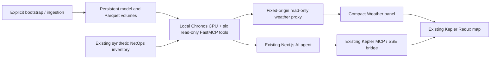
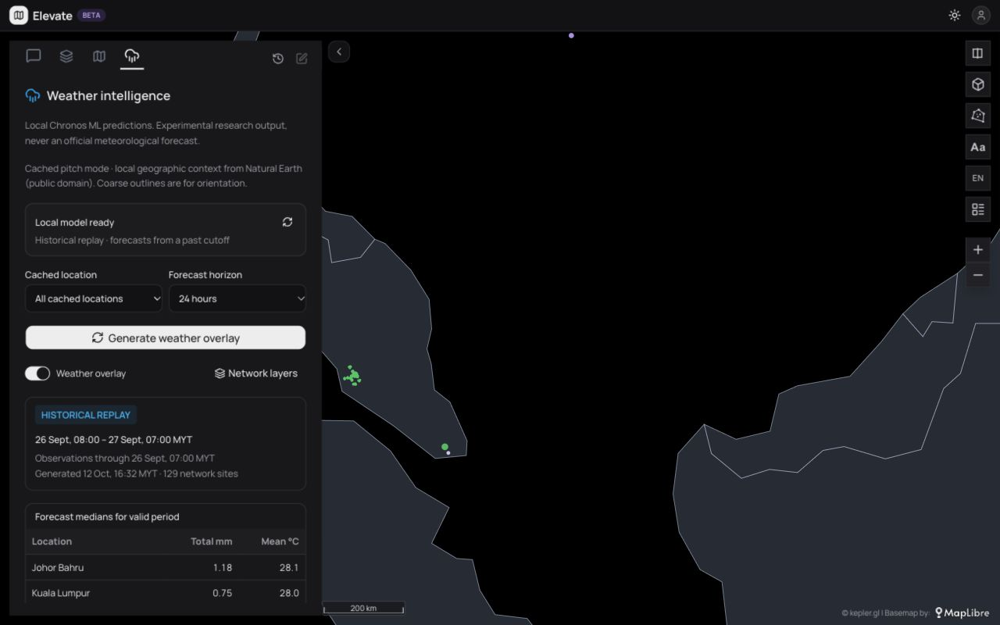

# Weather ML implementation and acceptance report

Verified on 12 October 2026 (Asia/Kuala_Lumpur), on local branch `feat/weather-ml-mcp`. Implementation and integration changes are committed locally; no push, pull request or remote merge was made. The latest fetched `origin/main` (`bdabf62e67b09e9382e92e48866b45938680e94b`) is an ancestor of this branch. Its Menara integrations and NetOps relocation to `backend/netops-mcp/` are preserved. Local `main` remains `9421f9e924caefbfc7a8bf5b491d63c4af292558`. No Hermes Ops/XSSHunter container or SSH tunnel was stopped, restarted, removed, or modified.

## Delivered architecture

`weather-ml-mcp/` is independently deployable using the approved Docker Desktop engine/Compose plugin. No alternative container runtime was installed. Native Linux ARM64 Python 3.12 loads the pinned `autogluon/chronos-2-small` snapshot through `chronos-forecasting` and CPU PyTorch. Actual tensors produce the forecasts; the existing Next.js agent only orchestrates tools and explains results.



Development publishes only `127.0.0.1:8002`, as approved because an existing SSH listener occupied 8001. The container listens on 8001 with `/mcp` streamable HTTP. Compose project `ai-elevate-weather` owns three persistent volumes: `model-cache`, `weather-data`, `evaluation-reports`. Runtime is non-root UID/GID10001, read-only filesystem/artifact mounts, 2 CPUs and 2.5 GiB limit, dropped capabilities, no-new-privileges, bounded logs, health/readiness checks, and `unless-stopped` restart policy.

Model ID `autogluon/chronos-2-small`, revision `ddec01313e50b6bc58ebaa92ede81bc24a3d9f9a`, weight SHA256 `492290ae82bb89f9769e3479ce90b3179de1f33e600c34daa0352531538b23cd`. Framework `chronos-forecasting==2.3.2`; Linux inference `torch==2.9.1+cpu`. No fine-tuning was performed. Dependency graph and Python/uv multi-architecture base digests are locked. Model/data caches are separate from the image and are never downloaded at server startup.

Explicit Open-Meteo ERA5 ingestion acquired 1,464 hourly records each for Kuala Lumpur, Penang and Johor Bahru, 1 August–30 September 2026. Precipitation, temperature, humidity, pressure, wind and cloud cover are validated with units/provenance/checksums and stored as Parquet. Inference initially uses univariate precipitation and temperature; other variables are cached for a later evaluated covariate experiment.

Default replay cutoff is `2026-09-25T23:00:00Z`; inputs after that time are excluded even though later observations exist in the cache. Outputs carry UTC and MYT valid times, median/q0.1/q0.9 values, acquisition/freshness metadata, nearest-location distance and warnings. Live mode refuses inputs older than six hours. ERA5 is retrospective gridded reanalysis, not an independent station feed; the initial archive cannot support a current live forecast.

The frontend adds a built-in connector and Weather tab without replacing the agent or existing map tools. The panel provides locations, 6/12/24-hour horizons, explicit historical/live mode, precipitation/temperature values, source/model links, a weather exposure legend and layer visibility controls. Weather-owned datasets use the `weather-ml-` prefix; switching/hiding them preserves existing map layers. An opt-in `LOCAL_LLM_REASONING_EFFORT=none` adapter setting was needed for the installed Ollama thinking model's stream; other models and unset behavior remain unchanged.

## Acceptance criteria

PASS means the stated check was actually performed or the delivered artifact was inspected. NOT VERIFIED marks an unexecuted deployment/quality claim; it does not mean a stub forecast is substituted. FAIL identifies a real unmet condition.

| Criterion | Status | Evidence / limit |
|---|---|---|
| Isolated branch, current upstream preserved, no publication | PASS | Local feature commits; `origin/main` ancestor verified; Menara/backend diff empty; local main unchanged; no push/PR/remote merge |
| Existing Next.js / Kepler / NetOps architecture retained | PASS | Additive connector/panel/service; NetOps source diff empty; existing agent still used |
| Existing MCP tools not renamed or removed | PASS | Existing NetOps MCP discovers 62 tools; Kepler original 12 remain; six new weather names do not collide |
| Actual pretrained ML, not LLM-generated weather | PASS | Direct Chronos tensor inference plus 108 backtest calls; existing agent returned the ML tool's structured forecast |
| Published Chronos interface and immutable weights | PASS | Official DataFrame method used; model-card revision and cache hashes verified |
| Python 3.12 ARM64 CPU compatibility | PASS | Actual image reports Linux ARM64, Python 3.12.15, torch2.9.1+cpu, CUDA unavailable |
| Linux AMD64 container execution | NOT VERIFIED | Multi-architecture bases and CPU dependency resolution supplied; AMD64 build/runtime not executed |
| No paid weather/inference service | PASS | Explicit public archive and model downloads; CPU inference/local Ollama agent check; no cloud inference called |
| Docker Desktop exclusively | PASS | Existing desktop-linux engine and Compose used; no alternative runtime installed |
| Independent Compose project and localhost binding | PASS | `ai-elevate-weather`; host 8002 / internal 8001; bound to 127.0.0.1 |
| Existing Hermes Ops / XSSHunter containers preserved | PASS | Existing container IDs retained; all lifecycle commands targeted only new weather resources |
| Locked dependencies, non-root, resource/security limits | PASS | uv.lock + pinned base digests; UID 10001; inspected 2 CPU / 2.5 GiB/read-only/capability settings |
| Container build, startup, health and readiness | PASS | Real Compose build/up; healthy container; `/healthz` and `/readyz` HTTP 200 |
| Structured application/runtime logs | PASS | JSON application/FastMCP/Uvicorn logs; library weight-loading progress is informational startup output |
| Persistent model and data caches | PASS | Exact model/data manifest hashes equal before/after restart; ready after recreation and restart |
| Explicit model bootstrap; no startup downloads | PASS | Bootstrap job acquires pinned snapshot; runtime offline flags + local_files_only; artifact mounts read-only |
| Reproducible separate ingestion and Parquet provenance | PASS | Three real archive acquisitions, request/unit/grid/acquisition/hash manifests; inference does not acquire data |
| UTC normalization and MYT display | PASS | Unit tests, real output timestamps, browser panel showing UTC cutoff 23:00 as MYT 07:00 next day |
| Coordinate/unit/duplicate/missing-record validation | PASS | Automated positive/negative cases; actual cache validation |
| No future observations in context | PASS | Cutoff filtering and causal-context tests; held-out chronological evaluation |
| Honest replay/live separation | PASS | Schema/tool/UI labels; stale live input rejected in real offline-cache check |
| Current live forecast with sufficiently fresh data | NOT VERIFIED | Supplied historical cache is stale; no fresh independent observation feed configured |
| Offline cached inference | PASS | Actual `--network none` container; read-only volumes; socket attempts forbidden; both targets returned valid forecasts |
| Six read-only MCP tools discoverable and callable | PASS | Actual streamable HTTP client discovers all six and invokes every tool; read-only annotations checked |
| Rainfall/temperature at 6/12/24 h | PASS | Both targets called at each horizon over MCP; direct evaluation of every horizon; validated output schema |
| Unavailable model/data never fabricated | PASS | Automated load/error/gap/staleness cases produce explicit errors; no fixture fallback in production |
| Source, model version, freshness, quantiles and warnings | PASS | Pydantic outputs and frontend contracts verified with actual results |
| NetOps geographic exposure join | PASS | 129 actual synthetic inventory sites joined to three cached weather locations; explicit distance/cap warnings |
| Exposure is transparent and not an outage classifier | PASS | Peak hourly median thresholds 2.5/10 mm/hour; synthetic flag and disclaimers; no LightGBM/outage claim |
| AI Elevate receives weather results | PASS | Real Next proxy validates 132 GeoJSON features; existing AI SDK MCP inspection discovers 6 tools |
| Existing AI agent invokes local weather inference | PASS | Local qwen3.5:9b with opt-in thinking disabled called `predict_rainfall`; structured output contained Chronos model ID, replay mode and six hourly points; no paid model used |
| Geography renders in Kepler | PASS | Automated browser generation and visible green weather/site points; saved screenshot |
| Weather visibility / existing layers preserved | PASS | Browser switch and MCP state checks; weather hidden while existing cities layer stayed visible; datasets retained |
| Compact panel and mode/source/unit/legend display | PASS | Browser screenshot/AX checks; table-clipping defect found and corrected |
| Prepared pitch defaults and cached geographic context | PASS | Production browser defaults to cached qwen3.5:9b; no_map with local Natural Earth outlines and forecast points renders; light/dark toggles retain cached setting |
| Deterministic replay across restart / unchanged network data | PASS | Exact semantic forecast hashes equal across recreation; preserved NetOps DB hash; repeated MCP call assertion |
| Full browser pitch with all Internet disabled | NOT VERIFIED | Actual model air-gap and frontend server egress-restricted checks pass; browser Internet was not globally disabled |
| Menara code/routes retained versus current upstream | PASS | `origin/main` ancestor; backend/toolkit/route diff empty; all routes compile |
| Menara multi-service workflows executed | NOT VERIFIED | These unrelated services were not started/reset as part of Weather scope |
| Cached-only startup and repeat procedure | PASS | demo.sh build/start executed with cached NetOps/Ollama; existing model/data reused; no reset/download/seed |
| Mandatory backtesting and baseline comparisons | PASS | Chronological 60/20/20 split, rolling origins, 108 direct calls, persistence/seasonal 24 h comparison; full actual report retained |
| MAE/RMSE/rainfall error/interval coverage by horizon | PASS | Actual metrics and diagnostics in evaluation report |
| Inference latency and memory measured | PASS | Mean 31.6 ms / p95 35.0 ms warm inference; peak whole-evaluation RSS 535.3 MiB; runtime snapshot 349 MiB |
| Operational forecasting skill / calibrated intervals | NOT VERIFIED | Small reanalysis replay, poor interval coverage in several cases, no independent station holdout |
| Automated backend/frontend tests | PASS | All original 52 tests rerun plus two pitch tests: 46 container + eight frontend; full lint and production build/TypeScript pass, including Menara routes |
| Root repository is already open-source licensed | FAIL | No root LICENSE/COPYING; public hosting grants no license |
| Upstream selected model/software/data licenses reviewed | PASS | Official sources; 104 installed distributions inventoried; 156 available license/NOTICE files preserved in report volume |
| Application-license assignment and full binary redistribution audit | NOT VERIFIED | Owner approval absent; root/service license not selected; metadata inventory does not prove full wheel/image obligations |
| Docker Desktop itself open source | FAIL | Explicit owner-approved proprietary runtime exception |
| Complete docs/startup/shutdown/troubleshooting | PASS | Service README, this report, evaluation, attribution/license audit, verification scripts |

## Actual verification results

Backend: `docker compose -p ai-elevate-weather run --rm tests` returned **46 passed**, including data/causality/schema/staleness/model/error/offline fixtures, all six MCP tools, HTTP health/readiness, NetOps adapter and GeoJSON. Fixtures are clearly synthetic unit-only inputs. Frontend: `npm run test:weather` returned **eight passed** (the original six plus two pitch-default checks); full ESLint and production build/TypeScript passed. The test command retains an informational Node module-format warning rather than changing the existing package's module semantics.

Real deployment verification called both forecast targets at all three horizons, site prediction, metrics, status and GeoJSON. The map response contains 132 points: three weather locations and 129 synthetic telecom sites. A separate container with networking disabled loaded cached weights/data and predicted both targets. Configuring those same stale inputs as live raised `STALE_OBSERVATIONS` without a forecast.

Next `/api/weather` accepted actual valid output and rejected unsupported 48 h requests. The app's normal `/api/mcp/inspect` connected to the weather server through AI SDK. The existing agent then called `predict_rainfall` through `/api/chat` with a local model and correctly described its output as historical replay. The local thinking-model stream failed before setting the opt-in reasoning option; this is documented and tested rather than replacing the agent.

Browser checks verified visible forecast geography and values, table layout, MYT labels, attribution links, and the visibility switch. Existing Kepler state retained `cities`; disabling weather affected only `weather-ml-low`. Existing NetOps MCP still returned 472 4G, 104 5G and 142 MOCN sites through its original inventory tool. No existing NetOps source files or tool names changed.



The original basemap verification image is retained as `weather-ml/weather-overlay.jpg`. The cached outline initially exposed an incomplete saved GeoJSON configuration; supplying the complete native Kepler layer configuration fixed it. The rebuilt browser visibly rendered the outline and predictions afterward.

## Predictive performance and limits

Read [actual evaluation](WEATHER_ML_EVALUATION.md) and [full numeric/provenance artifact](weather-ml/evaluation-report.json). Three locations,61 days, three test origins per location, and direct 6/12/24 h forecasts are a basic integration backtest, not a national operational validation.

| Target | Horizon | Chronos MAE | Chronos RMSE | Nominal80% interval coverage |
|---|---|---:|---:|---:|
| Precipitation (mm/hour) | 6h | 0.1607 | 0.2796 | 61.1% |
| Precipitation | 12h | 0.2766 | 1.0048 | 53.7% |
| Precipitation | 24h | 0.3735 | 1.0840 | 59.7% |
| Temperature (°C) | 6h | 0.2567 | 0.3283 | 74.1% |
| Temperature | 12h | 0.4773 | 0.7209 | 81.5% |
| Temperature | 24h | 0.9343 | 1.3397 | 56.9% |

Chronos beat both baselines on pooled hourly MAE in 12/12 comparisons. It did **not** win every rainfall diagnostic: seasonal naive had lower wet-hour MAE at 6 h and 24 h, and slightly lower 24 h accumulated-rainfall MAE (8.2778 vs 8.2868mm/window). Rainfall bias and undercoverage are material limitations. Keep this as experimental intelligence; enlarge wet/dry-season origins and locations, obtain an independent station holdout, evaluate past-only covariates, and calibrate intervals on a separate calibration set before stronger claims. No fine-tuning was justified by this small sample.

Historical reanalysis was acquired after replay dates and may contain revisions unavailable at the forecast origin. Application timestamp leakage is prevented; pretrained corpus overlap cannot be ruled out from the model card. Raw quantiles are not rainfall-event confidence, and summing hourly medians does not create a probabilistic accumulated-rainfall estimate.

## Startup, configuration and remaining work

Use [serviceREADME](../weather-ml-mcp/README.md) for exact bootstrap/ingest/evaluate/Compose/verification/shutdown commands. Running development URLs are `http://127.0.0.1:8002/mcp` and `http://127.0.0.1:3001`. The frontend uses `WEATHER_ML_HTTP_URL=http://127.0.0.1:8002`; the built-in connector defaults to that port. NetOps remains independently available on 8000. Local agent verification uses `LOCAL_LLM_MODEL=qwen3.5:9b`, `LOCAL_LLM_REASONING_EFFORT=none`; the pitch build labels that configured local model explicitly and defaults the picker to the existing local provider entry.

For an open browser map with a generated overlay, the integration verification can also inspect the real Kepler bridge:

```bash
docker compose -p ai-elevate-weather run --rm --entrypoint python tests \
  scripts/verify_deployment.py --url http://weather:8001 \
  --frontend-url http://host.docker.internal:3001 \
  --frontend-mcp-url http://127.0.0.1:8002/mcp
```

The frontend's pre-existing peer-lock inconsistency prevents a clean `npm ci` on this host; the verified no-lock-change workaround is documented in the serviceREADME. It remains a separate reproducibility issue. Existing application hardening/UI redesign was not undertaken. Changes remain the additive Weather panel, opt-in cached pitch defaults and tiny Link lint fix needed for checks.

[License audit](WEATHER_LICENSE_AUDIT.md) explicitly records the missing application license and Docker Desktop exception. No license was chosen on behalf of the owner. [Installed dependency metadata](weather-ml/dependency-licenses.json) and preserved upstream notices are evidence, not a complete binary redistribution clearance. Fresh live observations, independent weather validation, AMD64 execution and a full license decision/review remain **NOT VERIFIED**. The verified deliverable is local historical replay and its working MCP/map integration, not an official/current weather service.

## Local branch qualification and cached pitch

Latest upstream was fetched and merged **into the feature branch locally**. The one agent-instructions conflict was resolved by retaining the Menara cards/self-heal instructions and adding explicit distinctions between real Chronos ML tools and synthetic Menara Weather scenario tools. Backend/NetOps files and Menara toolkit/routes are unchanged relative to the fetched upstream. Production build includes all 18 routes; Menara server workflows were not exercised because their services were not started for this Weather scope.

The opt-in pitch build uses `NEXT_PUBLIC_WEATHER_DEMO_MODE=1`, the existing local-model ID and Kepler `no_map`. Four coarse country geometries are bundled from Natural Earth, pinned revision `ca96624a56bd078437bca8184e78163e5039ad19`, public domain, local SHA256 `93d31bf3cd11e6e56063be2cc83052e7f30677e44f2a40bf56f01fdb4d8121af`. Normal CARTO basemaps still need Internet; the prepared build self-hosts fonts. Attribution links need Internet only when opened. Full browser air-gap testing is **NOT VERIFIED**; actual Chronos `--network none` checks passed, and the existing local agent returned real MCP forecasts while the frontend server's non-local socket connections were explicitly prohibited during verification.

Repeated 24h replay geography/model/legend/warnings matched exactly, including across actual Weather container recreation: semantic SHA256 `597b03de4ce72ce14eb18dd125b8d8f57ba0aa122a8dcfa034d107621861bbe2`. Generation timestamps and data-age metadata intentionally change. The existing NetOps DuckDB SHA256 remained `8937f06bc992f17b0eccc1067d57a540c489b6659061d5d96f224957542fa9c5`; no reseeding/reset took place. Three real ERA5 locations and 129 synthetic NetOps sites use valid WGS84 coordinates, stable inventory IDs and one historical forecast valid period. This static location join does not imply matching historical network incidents or an outage classifier. All selected replay exposure categories are low; demo narration must preserve that result.

Use `bash weather-ml-mcp/scripts/demo.sh build` before the pitch, `... start` with existing cached NetOps/Ollama available, and `... check` after generating the Weather overlay. Startup uses only the prebuilt image and persistent artifacts (`--no-build --pull never`). Repeat by reloading the page, opening Weather and generating the same selection, or using New chat. Never reset a database, invoke Menara reset, delete volumes, or operate unrelated containers. Full commands and shutdown are in the service README.

Final publishing is intentionally pending human approval and authenticated GitHub access. No publishing command has run. A reviewable future PR body is saved in `docs/WEATHER_ML_PR.md`.

## Later publication commands (not executed)

Authenticate GitHub CLI first (`brew install gh` if absent, then `gh auth login`). After explicit approval:

```bash
cd /Users/saf/Desktop/Hackathon/ai-elevate
git switch feat/weather-ml-mcp
git fetch origin
git merge origin/main
# If upstream changed, resolve conflicts and rerun qualification before publishing.
git push --set-upstream origin feat/weather-ml-mcp
gh pr create --repo izzhamburhan/ai-elevate --base main --head feat/weather-ml-mcp \
  --title "feat: local Chronos weather ML MCP" --body-file docs/WEATHER_ML_PR.md
```

Do not run a remote merge until separately approved. Re-fetching and merging above affects only this feature branch; no force push or direct push to main is needed. All model weights, Parquet datasets, NetOps databases, dependency environments and secrets remain outside committed source.

Final local check: `bash weather-ml-mcp/scripts/demo.sh check` passed real rainfall/temperature at every horizon, deterministic repeated replay, all six tools, NetOps joins, GeoJSON, cached metrics, frontend proxy/connector, `no_map`/local-outline assertions and selective layer visibility preservation. The browser Layers tab retained cities (52 rows), local outlines (four rows) and forecast/site data (132 rows). Existing NetOps/Kepler discovery still returned 62/12 tools. Final native image reported Linux aarch64, Python 3.12.15, torch 2.9.1+cpu and CUDA unavailable; `/healthz`/`/readyz` returned 200. Weather used 356.6 MiB of its 2.5 GiB limit. All four unrelated container IDs were unchanged and SSH still listened on localhost 8001.
